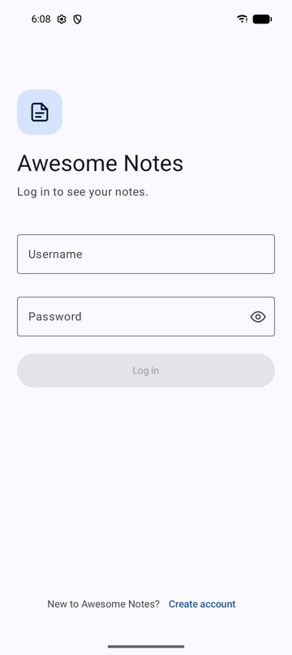
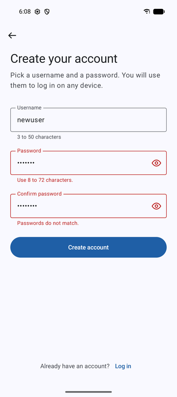
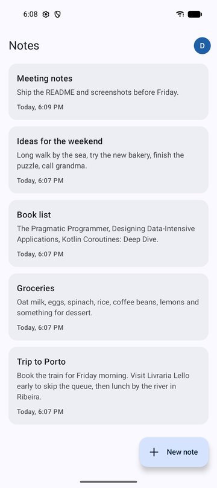
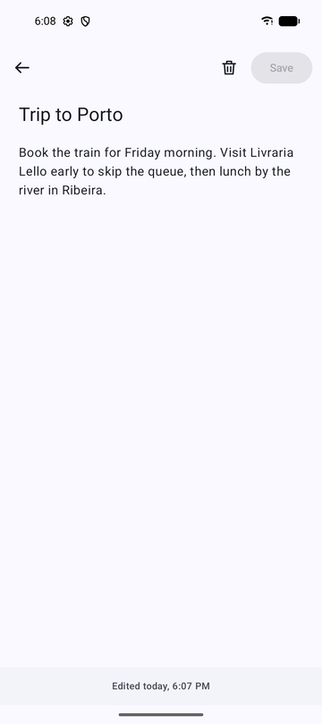
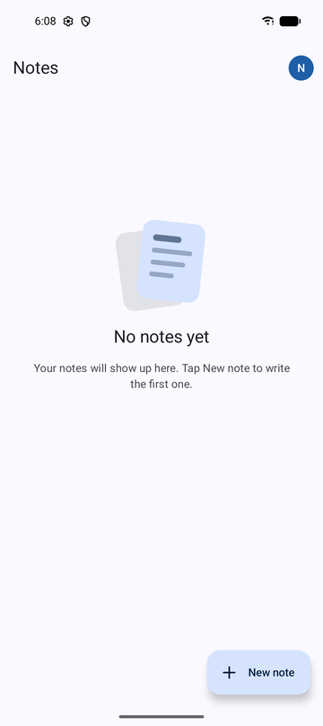
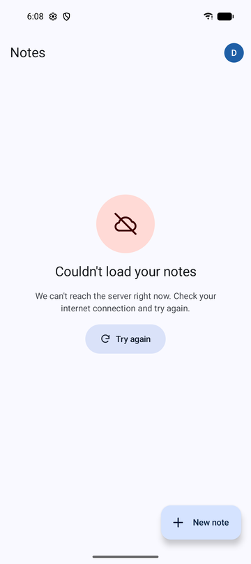
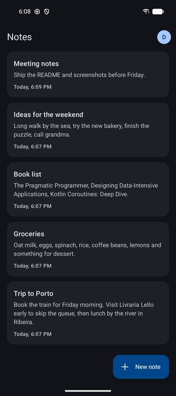
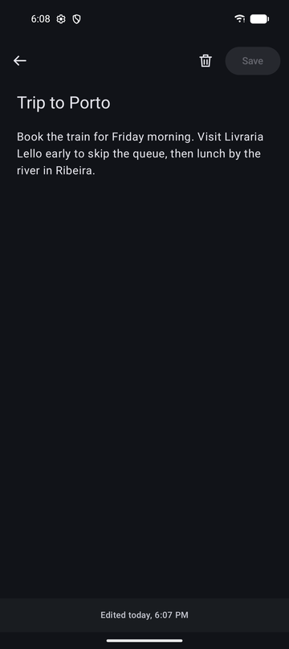

# Awesome Notes

A notes app for Android with its own backend. You can register, log in and out, and create, edit and delete notes.

- **Android app:** Kotlin, Jetpack Compose and Coroutines in a multi-module project. Material 3 with light and dark themes. Needs Android 13 (API 33) or newer.
- **Backend:** Ktor and PostgreSQL. One command starts both with Docker Compose.
- **Contract:** [`api/openapi.yaml`](api/openapi.yaml) (OpenAPI 3.0.3) is the only thing the app and the server share.

## Demo

Log in, write a new note, save it and open another one:

<p align="center">
  
</p>

### Screenshots

| Login | Register validation | Notes | Editor |
|:---:|:---:|:---:|:---:|
|  |  |  |  |

| Empty list | Can't reach the server | Notes (dark) | Editor (dark) |
|:---:|:---:|:---:|:---:|
|  |  |  |  |

## Running

You need Docker and a recent Android Studio. Gradle downloads the JDK 17 toolchain it needs.

### 1. Start the backend

```bash
docker compose up --build
```

This starts PostgreSQL and the server on port 8080. To check that it is up:

```bash
curl http://localhost:8080/health
```

The API documentation (Swagger UI) is at http://localhost:8080/docs.

### 2. Run the app

Open the project in Android Studio and run the `app` configuration on an emulator with API 33 or newer.

The app calls `http://10.0.2.2:8080/`, which is the host machine as seen from the Android emulator. To use a physical device, change `API_BASE_URL` in `core/network/build.gradle.kts` and the allowed domain in `app/src/main/res/xml/network_security_config.xml` to your computer's address on the local network.

### Tests

```bash
# Android unit tests (ViewModels, repositories, error mapping, validation, Koin graph)
./gradlew testDebugUnitTest :core:domain:test

# Backend integration tests against a real PostgreSQL (Testcontainers, needs Docker running)
./gradlew -p server test
```

## Repository layout

```
awesome-notes/
├── api/openapi.yaml       # API contract (source of truth for app and server)
├── app/                   # Android app module (composition root)
├── core/                  # domain, data, network, storage, database, ui, testing
├── feature/               # auth, notes
├── server/                # Ktor backend (separate Gradle build, own Dockerfile)
├── docs/media/            # Demo GIF and screenshots used in this README
├── docker-compose.yml
└── AI_USAGE.md            # How AI tools were used in this project
```

## Architecture

### Android app

```
feature:auth, feature:notes ──► core:ui ──► core:domain
                     └─────────────────────► core:domain ◄── core:data ──► core:network, core:database, core:storage
app ──► everything (Koin composition root, navigation)
```

| Module | Responsibility |
|--------|----------------|
| `core:domain` | Pure Kotlin: `Note`, `AppError`, repository interfaces, input rules |
| `core:data` | Repository implementations, error mapping, mapping between DTOs, entities and domain models |
| `core:network` | Ktor `HttpClient` (OkHttp, Bearer auth), `AuthApi`, `NotesApi` |
| `core:database` | Room database, `NoteEntity`, `NoteDao` |
| `core:storage` | `TokenStore` (DataStore) for the session token and username |
| `core:ui` | Material 3 theme, shared components (loading, error, banners) and error messages |
| `core:testing` | Fake repositories and test helpers shared by the feature tests |
| `feature:auth` | Login and register screens |
| `feature:notes` | Notes list and note editor |

Main choices:

- **Feature modules see only interfaces.** They depend on `core:domain` and `core:ui`, never on `core:data`, and the compiler enforces it. The `app` module wires the implementations with Koin.
- **Room is the source of truth for notes.** Screens observe Room, and the repository refreshes it from the API.
- **Offline reads, online writes.** Notes saved on the device stay readable without a connection. Saving and deleting need the server: if a write fails, the text stays on screen and a snackbar offers to try again. New notes get their UUID on the device, so retrying a create never makes a duplicate.
- **One state per screen.** Each ViewModel exposes a `StateFlow` of a sealed state, for example `Loading`, `Empty`, `Content` or `Error` for the list, and receives user actions as an `Intent` through `onIntent`.
- **No one-off event streams.** Things that happen once are part of the state. A failed save is kept in the state until the user retries, and a closed editor is a `Closed` state that the screen reacts to by navigating back.
- **The session picks the screens.** The app shows the auth graph or the notes graph depending on whether a session exists. Logging out, or a `401` from the server, clears the session and returns to login with an empty back stack.
- **Errors are values.** Repositories return Kotlin `Result` with a sealed `AppError`, mapped in `core:data` from the server's error code. Screens turn each error into a message.
- **No use-case layer.** The repositories already hold the logic, so use cases would only forward calls.
- **Process death.** Form fields and the editor draft are kept in `SavedStateHandle`. Passwords are not saved.
- **Libraries:** Koin for dependency injection, Ktor Client with kotlinx.serialization (the same library family as the server), Room, DataStore and type-safe Navigation Compose.

### Backend

- Ktor, Exposed and PostgreSQL, started with Docker Compose.
- **Opaque session tokens** stored in a `sessions` table, so logout revokes the session by deleting a row. Passwords are hashed with bcrypt.
- **Every note query is scoped to the authenticated user.** Another user's note returns `404`, not `403`, so the API does not reveal that it exists.
- **Errors have a stable shape:** `{ "code", "message" }`, with codes such as `INVALID_CREDENTIALS` and `USERNAME_TAKEN` that the app maps to its own errors.
- The app and the server share no code. The only shared artifact is the contract, [`api/openapi.yaml`](api/openapi.yaml).

## Limitations

- **No offline writes.** Creating, editing and deleting need a connection. Queued writes and conflict handling were left out on purpose.
- **Last save wins.** If the same note is edited on two devices, the later save overwrites the earlier one.
- **Sessions do not expire.** A session ends only when the user logs out.
- **Not included:** CI, a release build with R8, UI tests and a cloud deployment.

## Documentation

- [AI_USAGE.md](AI_USAGE.md): which AI tools were used, what they were used for, and what was corrected or rejected.
- Swagger UI at http://localhost:8080/docs while the backend is running.
